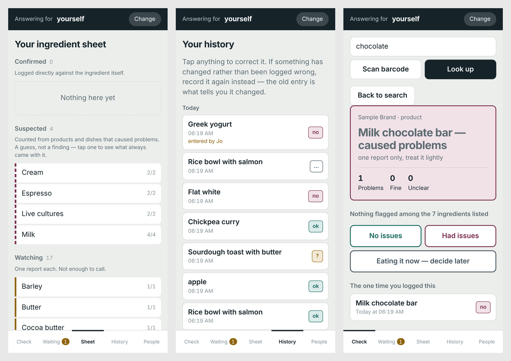

# Plate

  

**A household food log that tells you which ingredients keep turning up when something disagrees
with you, and admits when it does not know.** You log whether a food caused problems; Plate works
out which ingredients those foods have in common and gives you a sheet you can carry. It is built
for a small group (you, family, close friends) on your own server.

## The idea

Most food is **unknown**, and the app says so. It does not assume you can eat everything until
proven otherwise, or nothing until proven otherwise; both of those are guesses dressed as answers.

- **Three answers, not two:** no problems, had problems, or *eating it now* (decide later). A
  pending answer becomes *unsure* after 24 hours, and can still be corrected afterwards.
- **Three kinds of thing:** an ingredient, a packaged product, or a dish from a menu. A dish's
  ingredients are a best guess, so it is kept apart from a product.
- **Confirmed and suspected are never blurred.** The sheet splits into *confirmed* (logged against
  the ingredient itself), *suspected* (inferred from foods that caused problems, called only after at
  least two reports and a clear majority), *watching* (one report, not enough) and *no trouble so
  far*.
- **It says when it cannot tell.** If milk, lactose and whey always appear together, the counts
  cannot separate them, and the app shows that instead of picking one. There is deliberately no
  fitted model: with yes/no outcomes and ingredients that almost always travel together, a
  regression would be confidently wrong.

## Getting food in

- **Scan a barcode** with the phone's camera. A hit is looked up on Open Food Facts; a miss drops
  you into the add form with the barcode filled in, so the next person finds it.
- **Type what the menu says.** Menus are prose, not ingredient lists, so a parser splits them up,
  strips cooking words and prices, and pulls out common triggers hidden inside phrases ("lemon
  butter sauce" also gives "butter").
- **Nothing is counted until you have looked at it.** Both paths show what they found as editable
  chips before anything is saved.
- **Mistakes and changes are different things.** A wrong entry is edited; a food that has stopped
  causing trouble is logged again, so the record of the change survives.

## How it is built

- Python and FastAPI, SQLAlchemy over SQLite (Postgres by changing one setting), and a plain
  JavaScript front end that installs on a phone.
- Runs in Docker on a home server, reached over Tailscale or through a reverse proxy with HTTPS.
  The barcode reader is served by the app itself, so it works with no route to the internet.
- Invite-code sign-up for a household, and a "buddy" mode for logging on someone else's behalf.
- Exports: a plain-text avoid list that works on a phone with no signal, a one-page summary for a
  dietitian that carries its own caveats, and a CSV of every record.
- A smoke test of 76 checks covers the whole loop with no network.

## Where it is

Working and self-hosted; the pictures above use made-up foods. Not built yet: reading ingredient
labels from a photo (the text box is where it would plug in), reminders before a pending answer
expires, and how much and how bad.

Suspected ingredients are arithmetic on what people report, not a diagnosis, and the exports say
so on their face.

## How it was made

Designed and built by Will Douglas. Food data comes from
[Open Food Facts](https://world.openfoodfacts.org) (Open Database License). The barcode reader is
[ZXing](https://github.com/zxing-js/library) (Apache 2.0).

## What is in this repository

This is the project's public face, not its source. It holds this page, its picture and the licence.
The code is kept in a private repository. All rights are reserved; see [LICENSE](LICENSE).

This repository is written by a publish step from the private one; changes made here directly are
overwritten.
